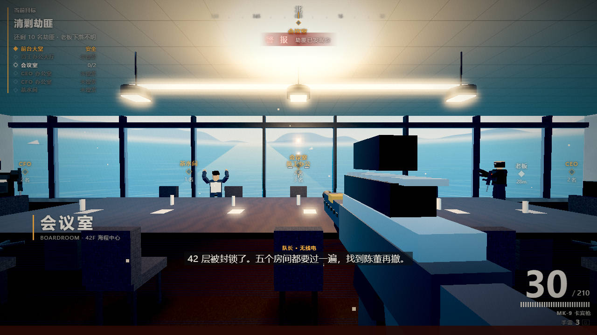

# 抢救老板 · Save the Boss

> 一款可直接在浏览器运行的 **4A 写字楼室内第一人称战术射击小游戏**：逐间清剿 42 层的劫匪，解救同事，最后在 CEO 办公室找到老板。

  

---

## 项目简介

22:47，一伙持械劫匪闯入 **海程中心 42 层**，封锁电梯、控制前台与员工区，老板被困在 CEO 办公室。

你是当晚值班的危机响应人员。楼层里还有 **10 名劫匪** 和 **5 名同事**。逐间推进：

- 员工办公大厅（3 名劫匪）
- 会议室（2 名劫匪）
- CFO 办公室（2 名劫匪）
- CEO 办公室（2 名劫匪）
- 茶水间（1 名劫匪）

**击败全部劫匪后，进入 CEO 办公室找到老板即可获胜。** 清空全层之前，老板不会跟你走。

场景是一整层 4A 写字楼：前台大堂、开放式办公区、玻璃会议室、两间高管办公室、茶水间与环形走廊；白天的高层视野，落地窗外是海面、海岸线与远山。

## 特色

- **单文件、零依赖、离线可玩**：`index.html` 内联 three.js 与全部资源，双击即开。
- **全部程序化生成**：大理石、地毯、木饰面、幕墙、监控画面、城市夜景、蓝调/暖光照明，无任何外部图片或音频素材。
- **自定义后处理**：Bloom + ACES 色调映射 + 暗角 + 胶片颗粒 + 边缘色差。
- **有反应的劫匪 AI**：视野锥 + 视线遮挡 + 听觉（枪声、冲刺脚步），A* 寻路、侧移、点射；受伤后会寻找掩体，并有人数限制的协同包抄。
- **三把武器 + 手雷 + 掉落换枪**：MK-9 卡宾枪、P-12 手枪，击倒劫匪可捡起 AK-74；碎片手雷有物理弹跳与范围伤害。
- **三级难度**：轻松 / 标准 / 硬核，影响敌人血量、伤害、反应与射速，以及玩家生命与手雷数。
- **检查点**：每次清空房间自动记录；阵亡后可「从检查点继续」或重新开始（刷新页面则重新开始）。
- **完整的营救流程**：人质可解开束缚自行撤离；老板在清场前会拒绝离开。
- **成套 HUD**：罗盘、房间清单（未搜索 / 已清剿）、命中反馈、受击方向、无线电字幕、动态准星。
- **键鼠 + 手柄 + 触屏**：桌面指针锁定，手柄即插即用，移动端自动切换虚拟摇杆与按钮。

## 截图



## 快速开始

1. 下载仓库中的 `index.html`。
2. 用 Chrome / Edge / Safari 打开（推荐桌面端，1080p 以上）。
3. 点击「进入 42 层」，再点击画面锁定鼠标。

> 也可直接访问 GitHub Pages（若仓库开启 Pages）：`https://david-lee-q.github.io/save-boss/`

## 操作

| 操作 | 键位 |
| --- | --- |
| 移动 | `W` `A` `S` `D` |
| 视角 | 鼠标（点击画面锁定） |
| 开火 / 瞄准 | 鼠标左键 / 右键 |
| 换弹 | `R` |
| 切换武器 | `Q`，或 `1` / `2` 直选 |
| 手雷 | `G` |
| 交互（营救 / 解绑 / 拾取，按住） | `E` |
| 近战 | `F` |
| 跳跃 / 冲刺 / 蹲伏 | `Space` / `Shift` / `C` |
| 静音 | `M` |
| 暂停 | `Esc` 或 `P` |

**手柄**：左摇杆移动，右摇杆视角，RT 开火，LT 瞄准，LB 换枪，RB 手雷，X 换弹，A 跳跃，B 蹲伏，Y 交互（按住），Start 暂停。即插即用，无需设置。

触屏：左半屏滑动移动，右半屏拖动视角，右下角按钮开火 / 瞄准 / 跳跃 / 换弹 / 换枪 / 手雷 / 交互 / 暂停。

## 任务与房间

```
                 z = -22  （落地窗 · 城市夜景）
   ┌───────────────┬────────────────┬────────────────┐
   │  CFO 办公室    │    会议室       │   CEO 办公室    │
   │  2 名劫匪      │   2 名劫匪      │   2 名劫匪      │
   ├───────────────┴────────────────┴────────────────┤
   │                环形走廊（东 / 西 / 北）           │
   ├──────────────────────┬─────────────────────────┤
   │    员工办公大厅       │        茶水间            │
   │     3 名劫匪          │       1 名劫匪           │
   ├──────────────────────┴─────────────────────────┤
   │            前台大堂 · 电梯厅（出生点）            │
   └────────────────────────────────────────────────┘
                         z = +22
```

- **NPC**：林小满（前台，员工大厅）、周敏（项目经理，会议室）、高维（财务总监，CFO 办公室）、许安（实习生，茶水间）、陈立群（创始人 / CEO，老板）。
- **武器**：MK-9 卡宾枪（30 发，全自动）、P-12 手枪（12 发，半自动）、AK-74（击倒劫匪后掉落，按 `E` 拾取替换）。
- **手雷**：默认 3 枚（难度不同），`G` 投掷，2.35 秒引信，物理弹跳，半径约 6.6 m。
- **补给**：弹药箱 +60 发、医疗包 +35 HP，散落在各房间与走廊。
- **检查点**：清空任意房间自动保存进度；阵亡后可继续或重开。
- **胜利**：10 名劫匪全部击倒 → 前往 CEO 办公室 → 按住 `E` 营救老板。
- **失败**：生命值归零。可重新进入，重试次数会记入结算。

## 画面与难度

设置面板可调：难度、画面质量（流畅 / 均衡 / 精细）、鼠标灵敏度、垂直视角反转、主音量、视野范围。质量档会影响分辨率倍率、Bloom 与阴影开销。

| 难度 | 玩家生命 | 手雷 | 敌人生命 | 敌人伤害 | 反应/射速 |
| --- | --- | --- | --- | --- | --- |
| 轻松 | 130 | 4 | 85 | ×0.62 | 更慢 |
| 标准 | 100 | 3 | 100 | ×1.0 | 标准 |
| 硬核 | 85 | 2 | 115 | ×1.35 | 更快 |

- 劫匪听到枪声会警觉并搜索；冲刺脚步也会暴露位置。
- 蹲伏能降低被命中率；瞄准镜显著收紧弹道。
- 生命值不会自动回复，请利用医疗包。

## 技术栈

- **Rendering**：three.js r160（UMD，内联）+ 自写 HDR 后处理链；白天海景全景 + 远山。
- **Gameplay**：三把武器 / 手雷 / 掉落换枪 / 三级难度 / 房间检查点；劫匪掩体与协同包抄。
- **Input**：键鼠（指针锁定）、Gamepad API、触屏虚拟摇杆。
- **Textures**：Canvas 2D 程序化绘制（大理石 / 木纹 / 地毯 / 吸音板 / 幕墙 / 城市 / 屏幕 / 标识）。
- **Audio**：WebAudio 实时合成（枪声、脚步、换弹、无线电、环境底噪）。
- **Level**：52 m × 44 m 单层平面，恒定 3.7 m 层高（大堂 5.2 m），AABB 碰撞 + 0.7 m 导航网格 A*。
- **Build**：`src/build.js` 将 CSS / three.js / 游戏脚本内联为单个 HTML。

## 目录结构

```
index.html              可直接运行的完整游戏（构建产物）
游戏说明书.md            详细玩法与系统说明
src/
  index.html            开发模板
  css/base.css          HUD / 菜单设计系统
  css/game.css          本作的界面补充
  js/three.min.js       three.js r160
  js/util.js            数学 / 画布 / 纹理工具
  js/post.js            Bloom + 色调映射 + 胶片后处理
  js/textures.js        程序化纹理
  js/audio.js           程序化音效
  js/level.js           42 层场景、家具、灯光、导航
  js/weapon.js          武器视图模型与命中特效
  js/npc.js             人形模型、劫匪 AI、碰撞与射线
  js/hud.js             罗盘 / 目标 / 提示 / 字幕
  js/game.js            主循环、玩家控制、流程与菜单
  build.js              打包脚本（node src/build.js）
```

## 构建

```bash
cd src
node build.js     # 生成 ../抢救老板_V1.html
```

## 浏览器要求

- 支持 WebGL2 的现代浏览器（Chrome / Edge / Firefox / Safari 15+）。
- 需要开启硬件加速；集成显卡建议在设置中选择「均衡」。
- 首次点击后才会启用音频（浏览器自动播放策略）。

## 已知限制

- 单层关卡；检查点仅在本次会话内有效，刷新页面即重新开始。
- 触屏布局在无头浏览器中验证，尚未在真机上逐一测试（按钮尺寸与手感可能需按机型微调）。
- 城市与室内细节为程序化几何，非外部美术资产。

## 许可

代码以 MIT 许可发布。three.js 遵循其自身的 MIT 许可。

## 致谢

玩法与 HUD 设计语言来自团队此前的港区行动原型；本作的场景、角色与逻辑均为独立实现。
